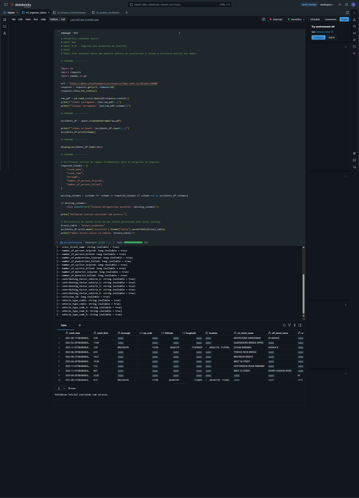
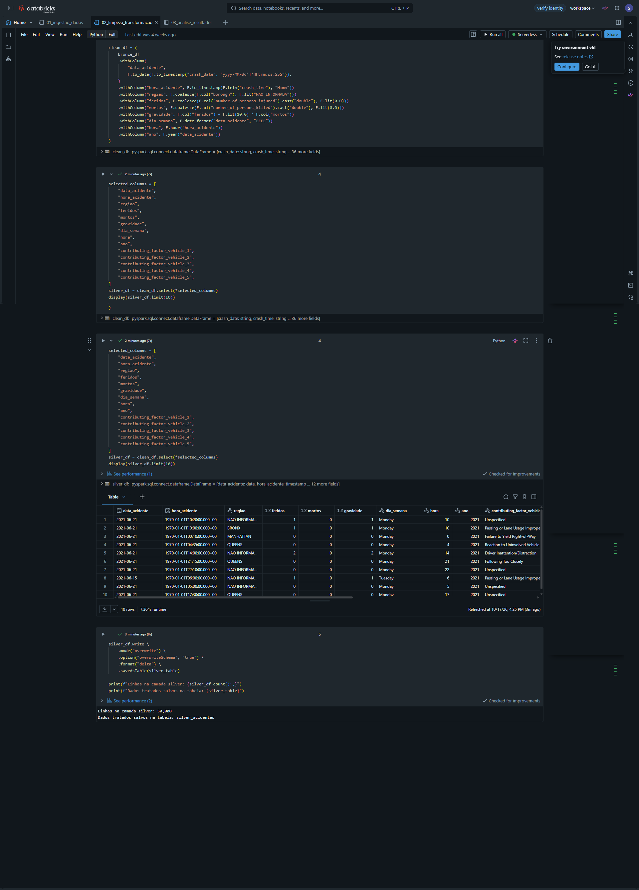
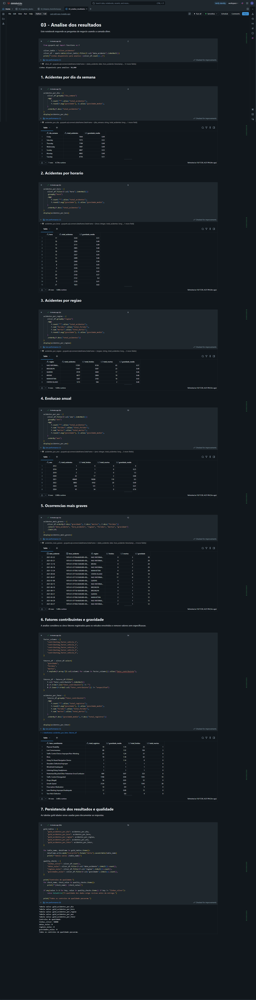

# MVP - Acidentes de Transito

## Objetivo

Analisar acidentes de transito para identificar quando e onde as ocorrencias se concentram e quais fatores aparecem associados a maior gravidade.

## Perguntas de negocio

1. Quais dias e horarios concentram mais acidentes?
2. Quais regioes apresentam mais ocorrencias?
3. Quais fatores estao associados aos acidentes mais graves?
4. Como o perfil das ocorrencias varia ao longo do tempo?

## Fonte dos dados

O MVP utiliza uma amostra de 50.000 registros do conjunto oficial **Motor Vehicle Collisions - Crashes**, publicado pelo NYPD no NYC Open Data por meio de uma API Socrata. Cada linha representa uma colisao reportada:

`https://data.cityofnewyork.us/resource/h9gi-nx95.csv`

O conjunto e publico no ambito da politica de dados abertos da cidade de Nova York. O registro do dataset nao informa uma licenca Creative Commons especifica; por isso, este projeto nao atribui uma licenca que a fonte nao declara. A fonte e a agencia NYPD estao atribuidas acima. Consulte tambem os [termos de uso do NYC.gov](https://www.nyc.gov/main/terms-of-use) e a [politica municipal de dados abertos](https://www.nyc.gov/opendata/get-started/what-is-open-data-). A coleta usada nos resultados foi realizada em 22/09/2026.

O proprio NYPD informa que os registros sao preliminares e podem ser atualizados quando detalhes do boletim de colisao forem revisados.

## Pipeline implementado

1. Ingestao dos dados brutos.
2. Persistencia da camada bronze.
3. Conversao e limpeza de datas e horarios.
4. Tratamento de valores ausentes.
5. Criacao de indicadores de data, horario e gravidade.
6. Agregacoes por periodo e regiao.
7. Analise dos fatores contribuintes registrados para os veiculos.
8. Persistencia dos resultados na camada gold.

As tabelas Delta sao gerenciadas pelo Unity Catalog no catalogo e schema ativos durante a execucao. Os notebooks usam nomes nao qualificados (`saveAsTable("nome")`), portanto o catalogo/schema efetivo deve ser registrado a partir do workspace com `SELECT current_catalog(), current_schema()`.

- `bronze_acidentes`: dados brutos validados.
- `silver_acidentes`: dados limpos e enriquecidos.
- `gold_acidentes_por_dia`: volume e gravidade media por dia da semana.
- `gold_acidentes_por_hora`: volume e gravidade media por hora.
- `gold_acidentes_por_regiao`: ocorrencias, feridos, mortos e gravidade por regiao.
- `gold_acidentes_por_ano`: evolucao anual das ocorrencias e da gravidade.
- `gold_acidentes_por_fator`: frequencia, feridos, mortos e gravidade media por fator contribuinte.

O notebook tambem exibe a lista dos 20 casos de maior gravidade. Sao **cinco tabelas Gold persistidas** e uma sexta saida analitica exibida no notebook; a lista dos 20 casos nao e salva como tabela Gold.

### Tratamentos realizados

- `crash_date` convertido para data a partir do formato ISO.
- `crash_time` convertido para horario, aceitando valores como `3:10`.
- Regioes ausentes substituidas por `NAO INFORMADA`.
- Feridos e mortos ausentes substituidos por zero.
- Indicador de gravidade calculado como `feridos + 10 * mortos`.
- Criacao das colunas `dia_semana`, `hora` e `ano`.
- Preservacao dos cinco campos de fator contribuinte para a analise final.

## Catalogo de dados

| Tabela | Camada | Conteudo e colunas principais |
|---|---|---|
| `bronze_acidentes` | Bronze | 50 mil registros da API, 29 campos originais, incluindo data, horario, borough, contagens de feridos/mortos e fatores contribuintes. |
| `silver_acidentes` | Silver | Data e hora tipadas; regiao; feridos; mortos; gravidade; dia da semana; hora; ano; cinco campos `contributing_factor_vehicle_*`. |
| `gold_acidentes_por_dia` | Gold | `dia_semana`, `total_acidentes`, `gravidade_media`. |
| `gold_acidentes_por_hora` | Gold | `hora`, `total_acidentes`, `gravidade_media`. |
| `gold_acidentes_por_regiao` | Gold | `regiao`, `total_acidentes`, `total_feridos`, `total_mortos`, `gravidade_media`. |
| `gold_acidentes_por_ano` | Gold | `ano`, `total_acidentes`, `total_feridos`, `total_mortos`, `gravidade_media`. |
| `gold_acidentes_por_fator` | Gold | `fator_contribuinte`, `total_registros`, `gravidade_media`, `total_feridos`, `total_mortos`. |

O nome totalmente qualificado e o local fisico das tabelas dependem do catalogo/schema ativos no workspace. Para registrar o catalogo usado, execute no Databricks:

```sql
SELECT current_catalog() AS catalogo, current_schema() AS schema;
SHOW TABLES;
```

## Qualidade de dados

As regras implementadas incluem validacao das colunas obrigatorias na Bronze, conversao da data e horario, substituicao de borough ausente por `NAO INFORMADA`, preenchimento de feridos/mortos ausentes com zero e derivacao de gravidade (`feridos + 10 * mortos`). O notebook 03 verifica a quantidade de linhas e valores nulos em data, regiao e gravidade.

Uma execucao anterior reportou 50.000 linhas e zero nulos para esses tres campos. A verificacao de datas foi corrigida depois: anteriormente a tabela era filtrada para remover datas nulas antes da contagem, o que poderia mascarar valores invalidos. **Reexecute o notebook 03 com a versao atual antes de tratar o zero de datas nulas como resultado confirmado** e anexe a captura da execucao.

Os nulos de regiao e de feridos/mortos sao convertidos para marcadores/zeros; isso permite executar as agregacoes, mas nao recupera a informacao original. A quantidade original de regioes ausentes e apresentada separadamente nos resultados.

## Estrutura

```text
mvp-acidentes-transito/
├── README.md
├── notebooks/
│   ├── 01_ingestao_dados.py
│   ├── 02_limpeza_transformacao.ipynb
│   └── 03_analise_resultados.ipynb
├── resultados/
│   ├── acidentes_mais_graves.csv
│   ├── acidentes_por_ano.csv
│   ├── acidentes_por_dia.csv
│   ├── acidentes_por_fator.csv
│   ├── acidentes_por_hora.csv
│   └── acidentes_por_regiao.csv
└── evidencias/
	├── 01_ingestao_dados.png
	├── 02_limpeza_transformacao.png
	└── 03_analise_resultados.png
```

## Ordem de execucao

Execute os notebooks nesta ordem no Databricks Free Edition:

1. `01_ingestao_dados.py`
2. `02_limpeza_transformacao.ipynb`
3. `03_analise_resultados.ipynb`

O notebook 01 cria `bronze_acidentes`, o notebook 02 cria `silver_acidentes` e o notebook 03 cria as tabelas gold.

## Resultados observados

As tabelas gold foram exportadas para a pasta `resultados/`. Os principais resultados observados foram:

- **Dia com maior volume:** sexta-feira, com 7.643 acidentes. Domingo teve a maior gravidade media entre os dias, com 0,53.
- **Horario com maior volume:** 17h, com 3.319 acidentes. A maior gravidade media ocorreu as 22h, com 0,66.
- **Regiao com maior volume conhecido:** Brooklyn, com 11.438 acidentes. A maior gravidade media entre as regioes identificadas ocorreu em Staten Island, com 0,48.
- **Registros sem regiao:** 17.286 ocorrencias, equivalentes a 34,6% da amostra. Por isso, `NAO INFORMADA` nao deve ser interpretada como uma regiao real.
- **Ano com maior volume:** 2021, com 40.648 acidentes, aproximadamente 81,3% da amostra. Esse desequilibrio limita comparacoes entre anos.
- **Ocorrencia mais grave:** acidente de 22/05/2021, em regiao nao informada, com 3 mortos e gravidade 30 segundo o indicador criado.
- **Fator mais frequente:** `Driver Inattention/Distraction`, com 14.108 registros, 7.202 feridos e 14 mortos.
- **Maior gravidade media:** `Physical Disability`, com 1,74, mas baseada em apenas 19 registros.
- **Fator com maior total de mortes:** `Unsafe Speed`, com 38 mortes em 2.124 registros e gravidade media de 0,91.

Os fatores sao registrados em ate cinco colunas por acidente. Portanto, os totais de `acidentes_por_fator.csv` representam registros de fatores, e nao necessariamente acidentes unicos.

Os arquivos `acidentes_mais_graves.csv` e os demais CSVs devem ser consultados para a apresentacao completa dos resultados.

## Limitacoes

- A analise utiliza uma amostra de 50.000 registros.
- Os dados representam ocorrencias registradas em Nova York e nao devem ser generalizados para outras cidades.
- A amostra e fortemente concentrada em 2021, portanto a evolucao anual nao representa uma serie temporal equilibrada.
- Uma parcela relevante dos registros nao possui regiao informada.
- A analise de fatores pode contar mais de um fator para o mesmo acidente.
- Fatores com poucos registros podem apresentar gravidade media alta por efeito de amostra pequena.
- A formula de gravidade e um indicador criado para este MVP, nao uma classificacao oficial de severidade.
- Associacao entre variaveis nao implica causalidade.

## Autoavaliacao

O MVP atende ao objetivo de construir um pipeline cloud de ponta a ponta e produzir agregacoes que distinguem frequencia de gravidade. A separacao Bronze/Silver/Gold e os controles de qualidade tornam as etapas compreensiveis e reproduziveis quando executadas no workspace correto. Escolhi tabelas Gold agregadas em vez de um esquema estrela dimensional para manter o escopo pequeno e responder diretamente as perguntas propostas; reconheco que isso limita consultas ad hoc e reutilizacao por outras analises.

Como limitacoes, a amostra de 50.000 registros esta concentrada em 2021, 34,6% dos registros nao informam borough, fatores podem aparecer em mais de uma coluna para a mesma colisao e o indice de gravidade e uma regra exploratoria, nao uma medida oficial. A amostra via API nao usa ordenacao explicita, portanto pode variar quando coletada novamente. Nao e possivel inferir causalidade.

Se o projeto fosse ampliado, eu registraria o catalogo/schema totalmente qualificado, adicionaria testes de duplicidade e de faixa para contagens, compararia amostras temporais equilibradas e criaria um dashboard com filtros por periodo e regiao.

## Evidencias de execucao no Databricks

As capturas abaixo foram feitas no workspace Databricks e mostram codigo, resultados e tabelas da execucao. O link do workspace pode exigir autenticacao; por isso as imagens ficam no repositorio para consulta sem acesso ao workspace.

### 01 - Ingestao



**Ressalva:** nesta captura o controle superior mostra `Interrupt`, e a saida visivel nao confirma a mensagem final de persistencia de `bronze_acidentes`. Para comprovar conclusivamente a conclusao da ingestao, atualize esta imagem apos uma execucao completa que mostre a mensagem `Dados brutos salvos na tabela: bronze_acidentes`.

### 02 - Limpeza e transformacao



A captura mostra a tabela `silver_acidentes`, os cinco campos de fatores contribuintes e a mensagem de gravacao com 50.000 linhas.

### 03 - Analise dos resultados



A captura mostra as analises, as cinco tabelas Gold e os controles de qualidade. **Ela foi feita antes da correcao da contagem de datas nulas**: o codigo visivel filtra `data_acidente` nula antes de calcular esse controle. Portanto, ela e evidencia da execucao daquela versao, mas nao comprova a verificacao corrigida. Reexecute a versao atual do notebook 03 e substitua esta captura para comprovar o controle sem esse filtro.

As imagens sao evidencias complementares; a verificacao final do catalogo deve incluir tambem o resultado de `current_catalog()`, `current_schema()` e `SHOW TABLES` no Databricks.

Os CSVs registrados correspondem a coleta de 22/09/2026, enquanto o print 03 mostra uma execucao posterior, em 17/10/2026. Como a chamada da API usa `$limit=50000` sem ordenacao explicita, as amostras podem variar entre execucoes; por exemplo, sexta-feira aparece com 7.643 registros no CSV e 7.644 na captura. Para uma entrega com numeros perfeitamente consistentes, exporte novamente os CSVs a partir da mesma execucao usada nas capturas e atualize as conclusoes acima.

## Ambiente

A execucao principal e feita no Databricks Free Edition com tabelas Delta gerenciadas pelo Unity Catalog. Nenhum token ou credencial deve ser salvo neste repositorio.

## Workspace Databricks

Workspace utilizado para executar os notebooks do projeto:

https://dbc-f42aec16-a27e.cloud.databricks.com/browse/folders/workspace?o=7474644927109024

O acesso ao workspace pode exigir autenticacao e permissao da conta do avaliador. O codigo e os resultados tambem estao disponiveis neste repositorio.
